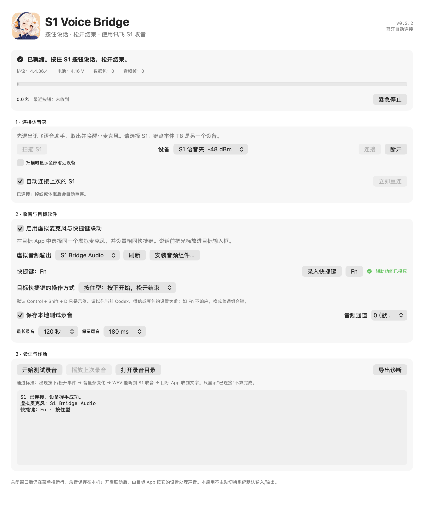
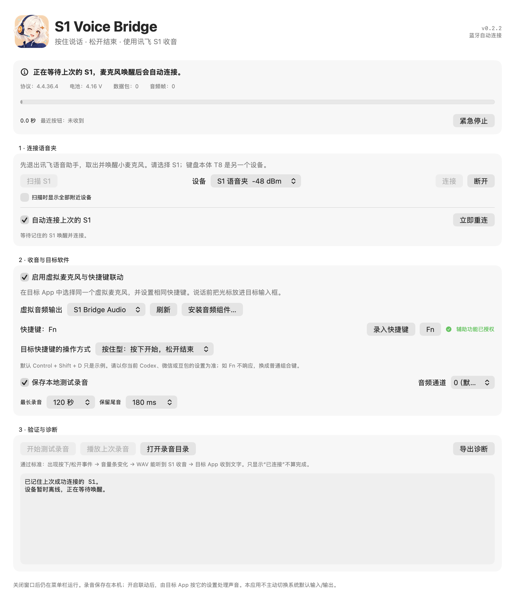

<p align="center"></p>

<h1 align="center">S1 Voice Bridge</h1>

<p align="center"><b>把讯飞 S1 语音夹，变成 Mac 上的无线「按住说话」按钮。</b></p>
<p align="center">按下收音 · 松开结束 · 唤醒自动连接</p>

<p align="center">
  <a href="README.md"></a>
  <a href="README.en.md"></a>
</p>

<p align="center">
  <a href="https://github.com/lianshuang-photo/s1-voice-bridge/releases/latest"></a>
  
  
  <a href="LICENSE"></a>
</p>

<p align="center">
  <a href="https://github.com/lianshuang-photo/s1-voice-bridge/releases/download/v0.2.2/S1-Voice-Bridge-v0.2.2-macOS-arm64.zip"></a>
</p>

<p align="center">
  <a href="#安装与首次测试">快速上手</a> ·
  <a href="https://github.com/lianshuang-photo/s1-voice-bridge/releases/tag/v0.2.2">更新说明</a> ·
  <a href="https://github.com/lianshuang-photo/s1-voice-bridge/issues">问题反馈</a>
</p>

---

S1 Voice Bridge 接收讯飞 T8 附带的 **S1 语音夹**的蓝牙收音和按钮事件，通过 **S1 Bridge Audio 虚拟麦克风**把声音交给语音输入工具，同时触发你指定的快捷键。让手边的小麦克风成为写代码、聊天和整理文字时的语音按钮。

**当前正式版本：v0.2.2。** 这是独立开源项目，与讯飞、豆包、微信或 OpenAI 没有官方隶属关系。

## 产品界面

<p align="center"></p>
<p align="center"><sub>由 v0.2.2 的原生界面代码导出；设备信息和诊断内容使用示例数据。截图展示操作界面，不代表额外的硬件验收。</sub></p>

<details>
<summary><b>查看「等待 S1 唤醒，自动重连」界面</b></summary>

<p align="center"></p>

首次手动连接成功后会记住设备。保持 App 在菜单栏运行，S1 唤醒后即可尝试恢复连接。

</details>

## 功能

| 功能 | 使用体验 |
| --- | --- |
| 🎙️ 按住说话 | 按下 S1 收音，松开后送完尾音并结束听写；不会自动发送消息。 |
| 🔁 自动连接 | 记住上次成功连接的 S1，支持启动重连、掉线重试和电脑休眠恢复。 |
| ⌨️ 快捷键联动 | 支持 Fn、自定义组合键，以及按住型或开关型语音输入。 |
| 🎚️ 虚拟麦克风 | 把 S1 收音交给可选择麦克风的第三方输入工具。 |
| 🧷 菜单栏常驻 | 关闭窗口后继续运行，保存快捷键、输出设备及联动设置。 |
| 🔍 收音检查 | 音量表、本地 WAV 录音、回放、诊断导出与最长录音限制。 |

发布包内置 Python 3.12，无需接收方另装 Python。

## 使用前提

1. Apple Silicon Mac，macOS 13 或更高版本。
2. 讯飞 T8 的 **S1 语音夹**。先在系统蓝牙设置中完成 S1 配对；仅配对 T8 键盘本体不够。
3. 本机已安装官方 **讯飞语音助手**：默认位置 `/Applications/iFLYAssistant.app`。已验证版本为 **4.4.36.4**，其他版本需兼容性检查。
4. 使用本工具时退出讯飞助手，避免双方争用设备；保留其安装文件。

本项目不分发讯飞代码、账号、凭据或其动态库，运行时只读取用户自己安装的设备协议与音频解码组件。
官方下载入口：[讯飞智能键鼠](https://mouse.iflytek.com/#/download)。

## 安装与首次测试

从 [Releases 下载 S1-Voice-Bridge-v0.2.2-macOS-arm64.zip](https://github.com/lianshuang-photo/s1-voice-bridge/releases/download/v0.2.2/S1-Voice-Bridge-v0.2.2-macOS-arm64.zip)。

1. 解压，把 **S1 Voice Bridge.app** 放到 `/Applications`，以后从固定位置运行。
2. 首次授予 App 蓝牙权限，取出并唤醒 S1，点“扫描 S1 → 连接”。
3. 先保持“虚拟麦克风与快捷键联动”关闭，按住 S1 说话并松开，用“播放上次录音”确认声音。
4. 安装附带的 `S1-Bridge-Audio.pkg`，或在 App 中点击“安装音频组件”。已有此驱动时不必重复安装。
5. 驱动名称是 **S1 Bridge Audio**。安装后若刷新仍未出现，需要重启系统音频服务或 Mac；单重启 App 不会重新加载系统驱动。
6. 在“隐私与安全性 → 辅助功能”中给 **S1 Voice Bridge** 授权，启用联动。App 输出与目标输入工具的麦克风都选 **S1 Bridge Audio**。
7. 设置和目标输入工具一致的快捷键，然后把光标放在输入框中，按住 S1 说话。

首次连接成功后，自动连接会记住这台设备。麦克风休眠时，App 会保持连接等待；唤醒后一般不需要再次扫描和点连接。
若在系统中“忽略设备”或更换 S1，请手动重新配对并成功连接一次。

### 豆包示例

如果豆包输入法的“长按模式”设为 **Fn**：S1 Voice Bridge 也选 **Fn＋按住型**，两边音频设备都选 **S1 Bridge Audio**，并给 S1 Voice Bridge 授予辅助功能权限。

默认 `Control + Shift + D` 只是示例，目标软件的快捷键应以当前设置为准。如果目标工具按一次开始、再次按键结束，可选“开关型”。

## 更新后反复提示授权

App 显示“辅助功能已授权”时无需再次操作；从系统设置返回 App 会自动刷新状态。

当前发布包使用本地 ad-hoc 签名，尚未做 Apple 公证。新版本的签名指纹会变化，macOS 可能保留旧版本的权限条目。
若开关已开启，App 仍提示未授权：在辅助功能列表移除旧的 S1 Voice Bridge，再从固定的 `/Applications/S1 Voice Bridge.app` 添加新版本，打开开关后重新运行 App。
不要把源码构建目录里的旧副本误当作正在运行的版本。

## 自动连接的边界

- App 必须保持运行；关闭窗口会留在菜单栏，“退出”才会停止后台连接。
- 不会自动更改系统配对、打开系统蓝牙、登录启动或抢连陌生设备。
- 初次使用必须手动选择一次；只记住**握手成功**的设备。
- 主动断开会暂停重连；重新打开 App 或点“立即重连”可恢复。
- 蓝牙关闭时等待，开启后恢复；连接失败使用最长 30 秒的退避。
- 设备拒绝验证、协议不兼容、解码失败等情况会暂停，避免无限重试。
- 麦克风刚唤醒时，先等界面显示“已就绪”再说话；首次唤醒按键不保证同时完成一整句听写。

## 验证状态

已完成 S1 真机连接、握手、实体按钮起止、16 kHz 音频解码和清晰回放；系统与豆包均识别了虚拟麦克风，使用者确认原始联动链路跑通。

v0.2.0 新增的自动连接、暂停、退避、休眠恢复与设置迁移通过离线测试。便携包通过换目录、清理外部 Python 环境后的运行检查。
v0.2.2 更新后已观察到一次自动重连与握手成功；多轮设备开关、休眠和长时间待机仍需进一步验收。微信、Codex 等其他输入工具取决于其音频设备选择和快捷键支持，尚未逐一兼容验收。详细范围见 [验证记录](docs/VERIFICATION.md)。

## 数据与权限

- 设置和最近设备标识只保存在本机：`~/Library/Application Support/S1VoiceBridgeDemo/`。
- 本地录音位于其中的 `Recordings/`，可关闭“保存本地测试录音”。
- `live-status.json` 保存状态、计数与近期诊断；导出不附带音频或识别文本。对外分享诊断前仍应检查设备信息和文件路径。
- App 本身不调用在线语音识别。开启联动后，由目标输入工具按其自己的设置处理声音。
- 不修改讯飞安装包、不写固件、不读取讯飞账户和历史记录。
- 不主动更改系统默认音频设备。如果输入工具只使用系统默认麦克风，需要你自行选择。

## 从源码构建

开发需要 Xcode 26 或更高版本（含 `actool` 图标编译器）、Python 3.12 与已安装的讯飞语音助手。

```sh
python3 scripts/build.py
python3.12 -m unittest discover -s tests -v
dist/'S1 Voice Bridge.app'/Contents/MacOS/S1VoiceBridge --self-test
```

构建便携包需要 uv / python-build-standalone 提供的 CPython 3.12：

```sh
python3 scripts/build.py --output releases/v0.2.2 --portable
python3 scripts/package_release.py --version 0.2.2
```

构建阶段只打包驱动，不执行系统安装或重启音频服务。`S1_PYTHON` 可指定构建用 Python 3.12。

文档界面图可通过 `python3 scripts/render_readme_screenshots.py` 重新生成；它使用隔离的示例数据，不连接硬件或触发快捷键。

## 组成与许可

- 原生 Swift 界面、CoreBluetooth、音频输出、按键映射与自动重连。
- 隔离的 Python 子进程调用本机已安装的设备协议和 ICO 解码组件。
- 虚拟音频基于 [BlackHole](https://github.com/ExistentialAudio/BlackHole) v0.7.1，原始源码、许可证和固定提交校验保存在 `third_party/BlackHole/`。
- 新增代码采用 GPL-3.0；便携包保留 CPython 及其附带组件的许可文件。
- 图标由 ImageGen 生成，原图和提示词位于 [Assets](Assets/IMAGEGEN.md)。
- 方案参考：[MiVibe Remote](https://github.com/wyuzhi/MiVibe-Remote)、[Open Voice Bridge](https://github.com/nijez/open-voice-bridge)。小米设备协议没有被用于驱动 S1。

## 移除

从菜单栏退出 App 后删除应用即可。录音与设置独立保留，按需要手动处理。
如果安装了独立音频驱动，其路径为 `/Library/Audio/Plug-Ins/HAL/S1BridgeAudio.driver`；移除该驱动需要管理员权限，之后重启音频服务或 Mac。
