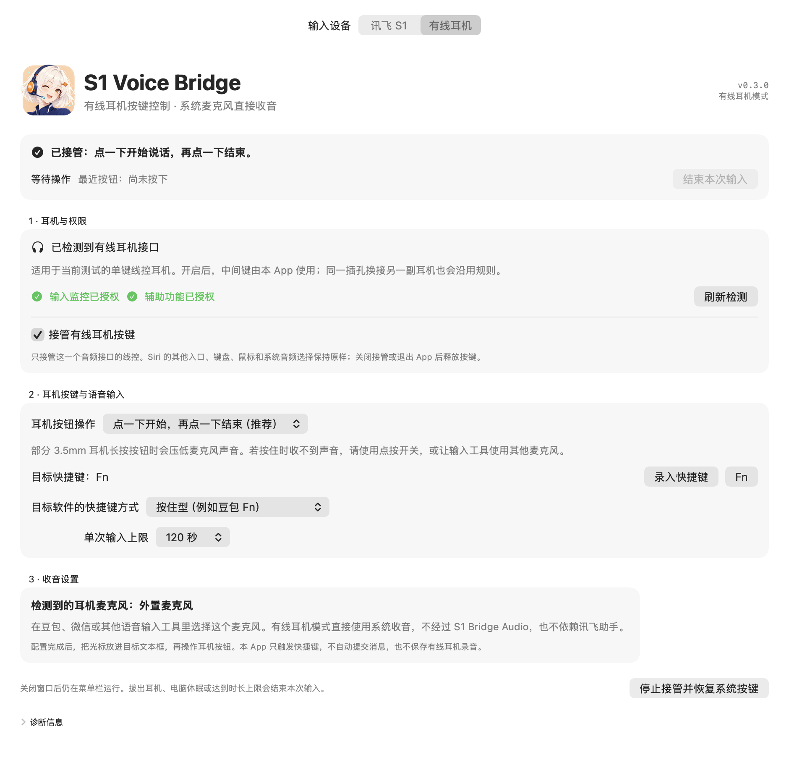

# 有线耳机模式 / Wired-headset mode

v0.3.0 预览版支持当前测试的 **Mac 内置 3.5mm 插孔 + 单键线控耳机**。通过耳机按钮控制目标语音输入工具，声音直接由目标工具从系统麦克风采集。

界面图由原生视图生成，使用示例状态。

## 设置

1. 将 App 放到 `/Applications/S1 Voice Bridge.app`，选择顶部“有线耳机”。
2. 分别授予“输入监控”和“辅助功能”权限，然后开启“接管有线耳机按键”。首次不会自动接管。
3. 耳机按钮操作保留默认“点一下开始，再点一下结束”。
4. 若豆包使用 Fn 长按输入，本 App 也选 Fn，目标快捷键方式选“按住型”。
5. 在目标输入工具中选择 **外置麦克风**，不要选择 S1 Bridge Audio。
6. 光标放进文本框，点按耳机键并松开后说话，再点按一次结束。不会自动发送消息。

耳机模式无需安装讯飞助手或音频驱动。它不录制或保存耳机声音；识别服务与声音处理由目标输入工具负责。

## 为什么默认点按

在已测试的单键耳机上，按住按钮时，麦克风仍输出数据但内容为静音；松开后恢复声音。因此默认在**按钮松开后**启动输入，再次点按后结束。若目标工具使用另一只独立麦克风，可以试用“按住说话”。

模拟耳机的按钮电阻与麦克风线路共用接口，相关电气背景可参考 [Android 耳机插孔规范](https://source.android.com/docs/core/interaction/accessories/headset/jack-headset-spec)。是否静音仍需逐副耳机实测。

## 作用范围与退出

- 只打开匹配 `Headset / Audio / Consumer Control` 的一个设备实例，不接管键盘、鼠标、USB 耳机或蓝牙耳机。
- 系统识别的是内置插孔的线控接口，无法可靠区分换接在同一插孔上的另一副模拟耳机。
- 开启接管期间，这个接口的原生 Siri / 播放暂停行为由 App 接管；关闭开关或正常退出后释放。
- 三键线控的音量转发尚未实现，本版仅面向单键耳机。
- 停止输入、切换模式、检测到拔出、电脑休眠和达到时长上限时，会释放本 App 发出的快捷键。
- 不修改全局 Siri 设置，也不自动切换系统输入或输出。输入工具内部的麦克风选择由用户完成。
- 关闭窗口会继续在菜单栏运行；可通过菜单停止接管或退出。

设置保存在 `~/Library/Application Support/S1VoiceBridgeDemo/headset-settings.json`，状态诊断位于同目录的 `headset-status.json`。它们不会包含音频或识别文字。

## English quick start

This preview supports the tested **single-button analogue headset remote on the Mac's built-in 3.5mm jack**. Select **有线耳机** (Wired headset), grant **Input Monitoring** and **Accessibility**, and enable takeover.

Keep the default click-to-start/click-to-stop interaction. For Doubao's Fn hold shortcut, choose **Fn** and **按住型** (hold) as the target shortcut mode. These are separate settings: a physical click can hold the target shortcut until the next click.

Select **External Microphone / 外置麦克风** in the target input tool. Click and release the headset button, speak, then click again to finish. No message is submitted automatically.

The tested headset becomes silent while its button is physically held. Starting on release avoids that limitation. Hold-to-talk remains available when another microphone is used, but has not been validated across headset models.

Only the selected `Headset` device with `Audio` transport is taken over. Global Siri preferences and system audio routing are unchanged. Turning takeover off or quitting releases the controls. USB/Bluetooth remotes and volume-button forwarding are not supported in this preview. The mode does not need iFLYTEK software or a virtual audio driver, and does not store audio.
